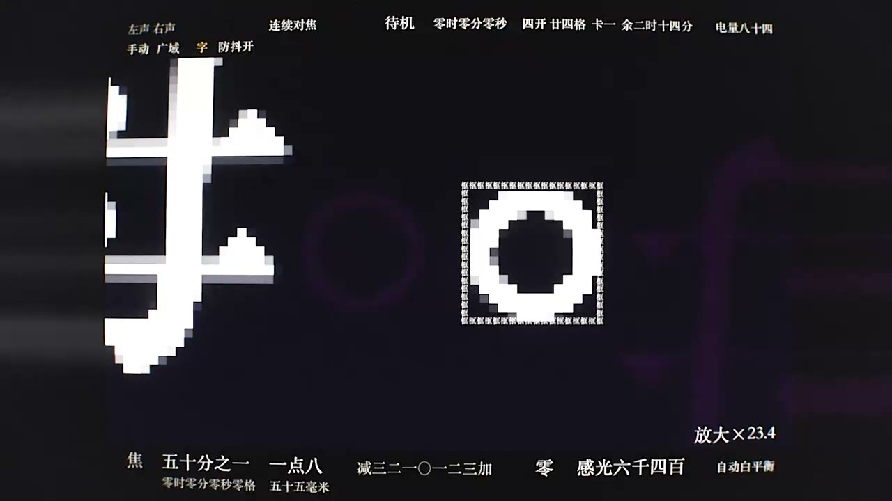
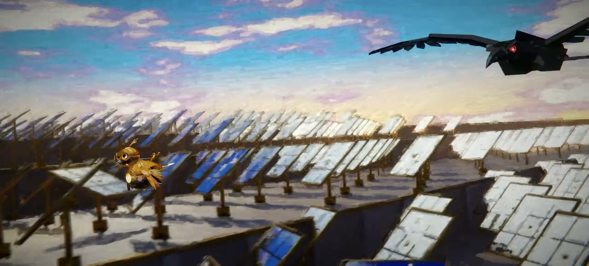

# 视频提示词

## Fable 5.5 个人测试（Moonlit1412）

B 站 UP 主 Moonlit1412 用灰度模型 Fable 5.5 做的 4 个纯代码视频测试。

| # | 截图 | 视频 | 主要提示词 |
|---|------|------|------------|
| 1 |  | [BV1FcxR6HEVQ](https://www.bilibili.com/video/BV1FcxR6HEVQ) | [吉卜力风格 2D 动画，原创巨型机器人](fable-5.5-test1-moonlit1412.md)（来源：X 用户 @chetaslua） |
| 2 |  | [BV16Wxd6sEgK](https://www.bilibili.com/video/BV16Wxd6sEgK) | [构建取景器里的世界，用手机拍这个取景器](fable-5.5-test2-moonlit1412.md) |
| 3 |  | [BV1Q7xR6zEH2](https://www.bilibili.com/video/BV1Q7xR6zEH2) | [双城之战风格短动画](fable-5.5-test3-moonlit1412.md) |
| 4 |  | [BV1b74i6DEMb](https://www.bilibili.com/video/BV1b74i6DEMb) | [仿 opus 5.5 宣发视频，中国传统意象](fable-5.5-test4-moonlit1412.md) |

截图取自各视频中段的一帧。
