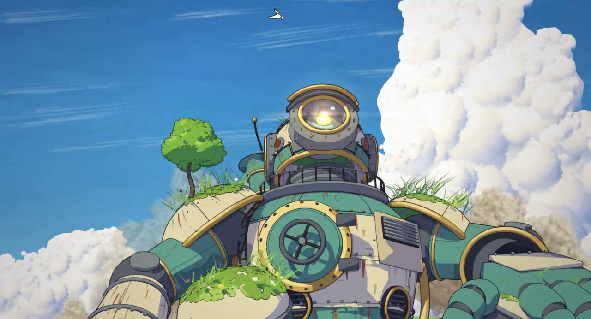

# Fable 5.5 测试 1：吉卜力风格 2D 动画（原创巨型机器人）



| 项目 | 内容 |
|------|------|
| 标题 | fable 5.5 个人测试，是的我灰度到啦 |
| UP 主 | Moonlit1412 |
| 链接 | https://www.bilibili.com/video/BV1FcxR6HEVQ |
| 发布时间 | 2026-11-04 |
| 时长 | 55 秒 |
| 系列 | Fable 5.5 个人测试，共 4 个，本视频为第 1 个 |
| 思考强度 | xhigh；约 3000 万 token，缓存率 97.0% |

## 提示词来源

提示词来源于 X 用户 **@chetaslua**（[原帖](https://x.com/chetaslua/status/2117169800271270124)）。为了快速测试，UP 主删掉了剧情相关的部分。基本是一次生成（oneshot），中途 UP 主指出过一帧错误。

## 提示词

```text
Create a 2D anime scene for the web. It must look completely like real
Japanese anime, as if it were taken directly from a finished theatrical
anime film. This is traditional-looking, hand-drawn 2D anime, not a 3D
animation, a moving illustration, or a stylized web graphic.

Deliver the final result as a single, self-contained HTML file. Use any
tools, libraries, references, guides, literally anything etc.

Use Studio Ghibli films as the art style reference for the design, line
work, painted backgrounds, color, and atmosphere. Create an original
giant robot as the main character. No people appear in the scene. Use
any tools or techniques you want, including 3D, as long as the final
result looks 100% like hand-drawn 2D anime.

ANIME QUALITY STANDARD
Every frame must look as if it was drawn by professional anime
animators and painted by master background artists for a finished
theatrical film.

You are free to change any part of the prompt, if it would result, in
better results. - AI art: No warped shapes, melted details, flickering,
or changing robot designs. - Non-anime art: No Western cartoon
designs, realistic rendering, soft painterly shading on the robot, or
generic digital illustration. - Amateur work: No stiff poses, empty
backgrounds, repeated trees, muddy colors, clip art, placeholders, or
unfinished details.

The result should feel awe-inspiring, nostalgic, and full of wonder,
like the moment an old forgotten dream comes back to life. Before
finishing, inspect random frames as still images. If any frame does not
look completely like real 2D anime, keep improving it. Do not stop
until every frame could pass as a still from a theatrical anime film.
```

## 评论区补充

- UP 主另做了「鹈鹕骑自行车」测试，提示词：

  > 画一张自行车骑鹈鹕的svg吧,加油.看起来真实一点?
