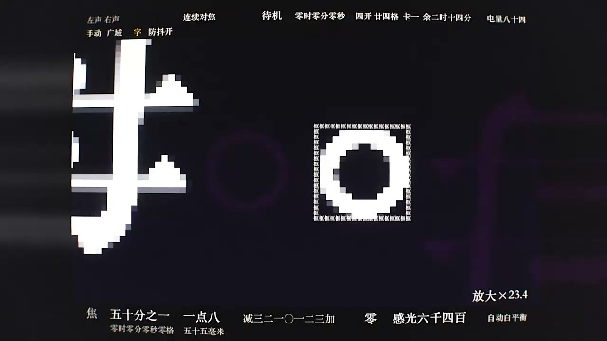

# Fable 5.5 测试 2：取景器里的世界

| 项目 | 内容 |
|------|------|
| 标题 | fable 5.5 个人测试2，灰度了 |
| UP 主 | Moonlit1412 |
| 链接 | https://www.bilibili.com/video/BV16Wxd6sEgK |
| 发布时间 | 2026-11-04 |
| 时长 | 1 分 38 秒 |
| 系列 | Fable 5.5 个人测试，共 4 个，本视频为第 2 个 |
| 思考强度 | xhigh；约 2 亿 token，缓存率 96.2% |

## 提示词

多轮对话，没有任何技术相关的提示。简介里给出的第一句提示词：

> 构建取景器里的世界，用手机拍这个取景器，需要多种风格。

置顶评论里给出的主要提示词：

> 做一个动画，构建取景器里的世界，再用手机拍这个取景器，需要多种风格。

## 限制与实现（来自置顶评论）

为了节省时间，UP 主禁止使用建模软件，并要求优先用着色器而不是物理模拟，所以这是模型的「一般发挥」。

- 代码：Python + GLSL
- 外部资源：仅字体
- 声音：程序合成，模拟麦克风效果
- 建模：用 Python 代码计算，不用建模软件
