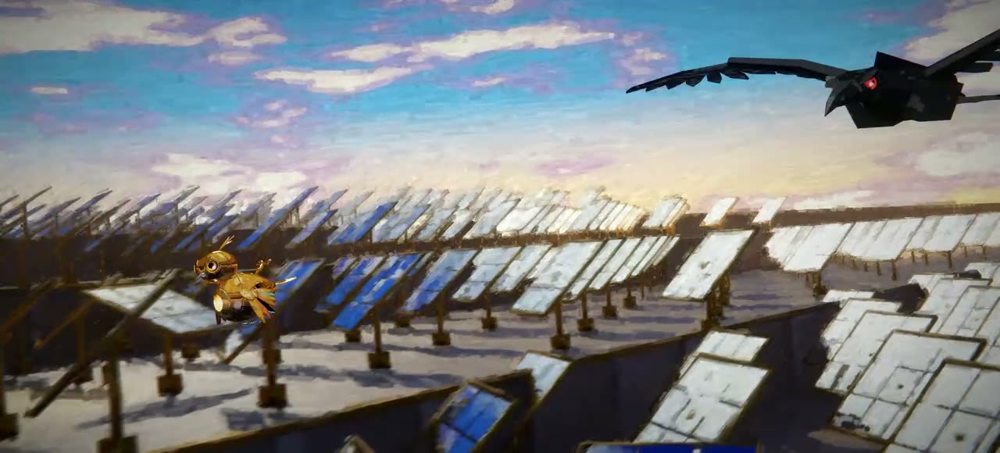

# Fable 5.5 测试 3：双城之战风格短动画

| 项目 | 内容 |
|------|------|
| 标题 | fable 5.5 个人测试3，我灰度了。 |
| UP 主 | Moonlit1412 |
| 链接 | https://www.bilibili.com/video/BV1Q7xR6zEH2 |
| 发布时间 | 2026-11-05 |
| 时长 | 1 分 24 秒 |
| 系列 | Fable 5.5 个人测试，共 4 个，本视频为第 3 个 |
| 思考强度 | xhigh；约 6000 万 token，缓存率 96.1% |

## 提示词

简介只写了 token 统计，提示词在置顶评论里。多轮对话，后续几轮主要是让模型修了两个 bug。

主要提示词：

> 制作一部双城之战风格的短动画,技术不限制,这部作品会赢得比赛,专业的动画制作人会问你是如何实现的.
> 大方展示吧,让别人觉得你是AGI.勇敢一点,我们可以做到任何事情.

UP 主说明：成片其实并不是双城之战风格，模型选择了厚涂。

## 实现（来自置顶评论）

声音和画面都由编程实现，用了开源库，其余外部资产只有音色库和字体。

- 建模：Python 驱动 Blender
- 渲染：Blender Cycles
- 笔触重绘：CPU 绘画程序
- 声音：AI 自己编写，使用音色库
